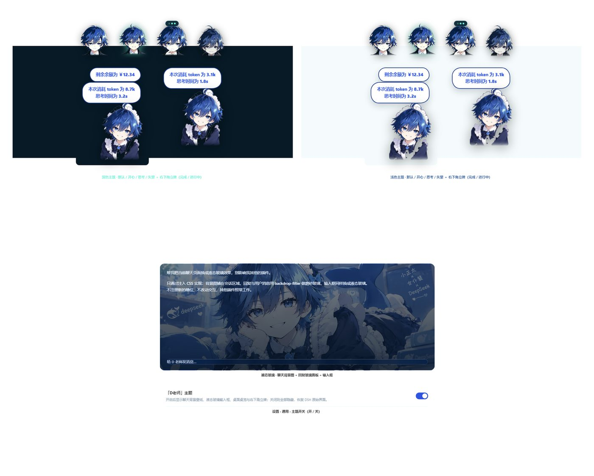
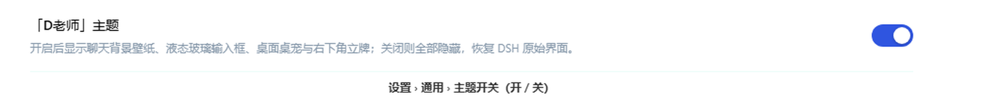

# 「D老师」桌宠 · DeepSeek Harness 主题插件

一只可以**拖到任意位置**的二次元男版女仆桌宠，外加右下角**立牌**、聊天区**背景壁纸**、
**液态玻璃**输入框与一组深海蓝配色。全部功能打包成一个零依赖的 DSH 插件。

> 一个插件、一个开关：不想要的时候滑一下，DSH 立刻回到原样。

[](https://github.com/use3346631993/dlaoshi-outfit/actions/workflows/ci.yml)
[](LICENSE)
[](https://github.com/use3346631993/dlaoshi-outfit)
[](https://github.com/use3346631993/dlaoshi-outfit/releases/latest)

> **不想看源码？** 直接下载 [v2.0.1 发布包](https://github.com/use3346631993/dlaoshi-outfit/releases/latest)，解压后按下面的三步安装。



## 功能

| 功能 | 说明 |
| --- | --- |
| 🐟 浮动桌宠 | 4 种表情（默认 / 开心 / 思考 / 失望），可自由拖拽，位置会记住 |
| 🎯 状态联动 | 自动跟随对话：流式输出时进入思考态，成功转开心，报错转失望 |
| 🖱️ 点击互动 | 单击切换表情（会自己回到默认），带语音气泡与"别戳啦"等台词 |
| 🪧 右下角立牌 | 常驻右下角，每轮结束弹出气泡：**本次 token 消耗**、**思考时间** |
| 🫧 点击立牌 | q 弹回弹 + 气泡膜"啵"声 + 单独一个余额气泡（读取官方 `deepseekAccount`） |
| 🖼️ 聊天背景 | 用你自己的插画做会话区壁纸，主题自适应蒙版保证可读性 |
| 🧊 液态玻璃 | 输入框磨砂玻璃 + 高光描边（不再有黑气泡，消息为纯文字） |
| ⚙️ 主题开关 | 设置 › 通用 里的滑动开关：一键启用 / 禁用整套外观 |

## 安装

前置：已安装 **DeepSeek Harness（桌面版）**，并至少启动过一次（生成了 profile）。

### 1. 克隆到 profile 的 `node_modules`

```powershell
# 把仓库放到任意位置，例如 C:\Users\你\Documents\dlaoshi-outfit
git clone https://github.com/use3346631993/dlaoshi-outfit.git C:\Users\你\Documents\dlaoshi-outfit
```

然后在 profile 的 `node_modules\@local` 下建立同名目录（**复制**，不是软链接）：

```powershell
mkdir "$env:USERPROFILE\.dsh\profiles\desktop\node_modules\@local\dsh-fatfish-outfit" -Force
Copy-Item "C:\Users\你\Documents\dlaoshi-outfit\*" `
  "$env:USERPROFILE\.dsh\profiles\desktop\node_modules\@local\dsh-fatfish-outfit" -Recurse -Force
```

### 2. 在 profile 里注册插件

编辑 `%USERPROFILE%\.dsh\profiles\desktop\package.json`，加两处：

```json
{
  "dsh": {
    "profile": {
      "bundles": [
        "@deepseek-ai/dsh-base",
        "@deepseek-ai/dsh-web-app",
        "@local/dsh-fatfish-outfit"
      ]
    }
  },
  "dependencies": {
    "@local/dsh-fatfish-outfit": "file:C:/Users/你/Documents/dlaoshi-outfit"
  }
}
```

> 完整示例见 [`examples/profile.package.json`](examples/profile.package.json)。

### 3. 重启 DeepSeek Harness

**完全退出应用再启动**（不是刷新网页）。右下角出现桌宠即安装成功。

## 使用

- **拖动**：按住桌宠拖到任意位置，松手即停留，下次启动还在原地
- **点击桌宠**：依次切换 开心 → 思考 → 失望 → 默认，几秒无操作自动回默认
- **点击右下角立牌**：q 弹一下、响一声气泡膜"啵"、弹出余额气泡
- **主题开关**：设置 › 通用 › 「D老师」主题

  

  - **开**：壁纸 + 液态玻璃 + 桌宠 + 立牌 + 侧栏头像
  - **关**：以上全部隐藏，恢复 DSH 原始界面（开关状态会记住）

## 兼容性

- 只依赖 DSH 自带的 Client 运行时与官方 `deepseekAccount` 能力，**无第三方依赖**
- 客户端 bundle 单文件自包含：所有图片内联为 data URI，不需要联网加载素材
- 宿主路由仅监听 **回环地址**（`127.0.0.1`），不对外暴露
- 余额只在点击立牌时读取，结果缓存 60 秒
- 若 DSH 版本较旧、没有 `settings.general.item` 槽位：开关不显示，其余功能照常

## 目录结构

```
.
├── client.js              # 浏览器端：桌宠 + 立牌 + 主题皮肤 + 设置开关
├── index.js               # 宿主端：turn 统计 + /fatfish/* 路由
├── package.json           # 插件清单
├── cordis.patch.yml       # bundle patch，让 DSH 自动挂载
├── assets/                # 原始立绘（运行时不需要，改素材用）
├── tools/                 # 抠图 / 生成壁纸 / 内联素材脚本
├── test/                  # 无浏览器行为的 Node 测试
├── docs/                  # 截图与技术说明
└── examples/              # profile 配置示例
```

## 开发

```powershell
npm run check   # 语法检查
npm test        # 四套行为测试（表情循环 / 状态机 / 立牌气泡 / 宿主统计）
```

测试不依赖浏览器：它们用假的 DOM、假的 `React`、虚拟时钟和假的 Cordis 上下文，
直接驱动真实的 handler 与宿主逻辑。

### 更换素材

```powershell
# 1) 从插画里抠出立牌（透明背景）
python tools/cut_portrait.py path/to/your-art.png
# 2) 生成 1600px 宽的聊天壁纸
python tools/make_wallpaper.py path/to/your-art.png
# 3) 重新内联进 client.js（会改写 client.js 里的 __SPRITE_*__ 占位）
python tools/inline_sprites.py
```

依赖：Python 3 + Pillow + numpy。

## 技术要点

详见 [`docs/architecture.md`](docs/architecture.md)。

- **单文件客户端**：DSH 的模块表只解析包根 specifier，所以图片必须内联
- **不抢事件**：立牌是桌宠拖拽层的子节点，指针事件显式拦截，点击不会被拖拽吞掉
- **动画可重播**：q 弹用两套同名不同名的 keyframes 交替，保证每次点击都从头播
- **玻璃不闪屏**：`backdrop-filter` 放在 `::before` 图层，光标闪烁不再触发背景重采样
- **开关可回退**：所有皮肤规则挂在 `html.dlao-skin-on` 下，关掉即恢复原生界面

## 许可

- **代码**：MIT，见 [`LICENSE`](LICENSE)
- **角色立绘**：由作者提供，**不包含在 MIT 授权内**，见 [`NOTICE`](NOTICE)

如果你要再分发角色形象，请先确认原画授权。

## 致谢

- [DeepSeek Harness](https://github.com/deepseek-ai) 的插件体系与官方 `deepseekAccount` 能力
- 灵感来自各类「桌面宠物 + 状态气泡」实现
